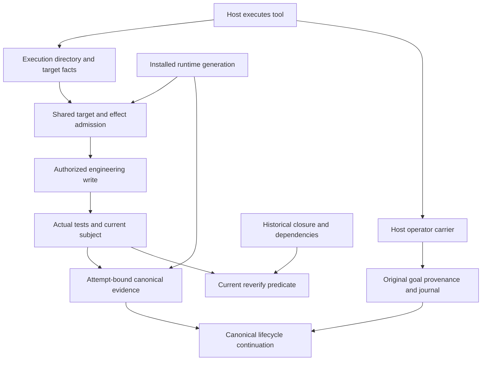

# Resilience audit: bounded successor SCOUT

This is safe independent SCOUT for the unconsumed audit
`audit/SAIPEN_20261010_1136.md`, SHA-256
`8d54708e5daccb690cc464918d4c81d7f1d2d4ed0f036a62a6e0c2f5ab0c2ce6`.
It is not that Source's admission, full audit acceptance, implementation grant
or closure. `audit-inbox.json` witnesses the generation as NEW. The active
T-1703 claim and pending T-1705 family remain intact.

## Verdict and evidence boundary

The current evidence establishes specific implementation and integration
problems, and one measurable conformance-freshness coupling. It does not prove
that every refusal shares a single architectural defect. The T-1705 relative
target/write-effect defects are reproducible and corrected in the carried
source. The missing live operator carrier remains a genuine authority boundary;
local inspection, engineering validation and independent evidence can continue
without turning those activities into lifecycle or publication authority.

The original SAI_WEBSITE T-31 session was not acquired in this pass. Its E-354
description is an incident report, not a reproduced current-runtime defect.
Likewise, an unsupported attempted verb does not establish a missing supported
route. These distinctions must survive the eventual full audit.

## Confirmed observations and ownership

| Observation | Evidence | Owner and consequence |
| --- | --- | --- |
| Relative canonical writes and literal output writes escaped preflight before the correction | `regression-control-v2.json`: unchanged oracle, 20 tests, identical 35 red subcases twice on old implementation | `guard_events` / `admission`; correction reuses the existing effect and target owners |
| A proper host execution-directory carrier is necessary | Existing new transport controls, plus `native-host.json`: actual OpenCode workdir append refused | Host translation supplies facts; the shared guard decides; no universal host-interception claim |
| A source change invalidated one historical current-tree receipt and made native core fail | Earlier native output; `native-reverify.json`: RV-000014; `native-core-pre-family.json`: subsequent CURRENT_PASS | Existing closure-evidence/reverify owners; observed whole-tree freshness cost, not proof of a false refusal |
| Engineering permission and durable lifecycle authority are distinct in this live session | SRC-208 start result, `current-status.json`, E-14231, unchanged 0/20 active REVIEW position | `operator_task` / `goal_authority` / journal; local work allowed, legacy goal reset not established |
| Persistent continuation and a prospective legacy transition already exist | `MAINTENANCE.md` GOAL-01, `goal_authority.prove/reset_authority`, T-1704 implementation report, `evidence-current-cycle.json` (69 tests pass) | Reuse the original operator grant and existing transition; do not implement another grant engine |
| AUDAPACK's historical hand-written lifecycle is not validated by passing product tests | `../AUDAPACK-T299-forensics/REPORT.md`, original source/operation acquisition | Historical claim is NO_GO; the actual FreeBuff trace proves an out-of-band append; individual duplicate-row writer remains UNKNOWN |

Memory-card and historical report assertions are reference evidence, not fresh
live verdicts. The nine current native warnings are retained. No numerical
availability or false-block-rate baseline was measured.

## Root-cause graph and incident map

T-1705 broke the facts/effect edge, not the original-goal proof edge.
The live 0/20 stall is absence of that goal proof's required fresh host carrier,
not evidence that the implemented persistent profile stopped after 20 tickets.
SAI_WEBSITE's incident could involve attempted unsupported commands, current-cycle
selection, installed generation or an agent routing error; direct acquisition
and a consumer-compatible disposable reproduction must choose between them.
AUDAPACK's acquired evidence establishes bypass outside SAIOPS, while the
missing blocking hook is separately an integration limitation.

## Existing mechanisms to extend

Use `host_integration.capability_contract` for declarations and its doctor plus
`admission.effective_strength` for installed/current/observed facts. Use
`operator_task` and `goal_authority` for provenance. Use `entry`, `router`,
`reconcile`, the operation journal and approved recovery owner for continuation.
Use the canonical `automation` block for machine eligibility and
`disposition.classify_carrier` for typed handbacks. Use `oracle` and
ticket-current `log.regression_evidence` for the comparison, `checkpoint` for
supported recording, and existing `work reverify` for closed Work's freshness.

A new competing Resilience Layer is not justified by these observations.
Any eventual coordinator must call these owners and preserve their decisions.

## Safe continuation decision matrix

| Boundary | Operation that stops | Safe independent work | Permitted route |
| --- | --- | --- | --- |
| Missing/forged operator goal proof | Goal pivot, persistent grant, bounded reset | Read, isolated reproduction, local engineering evidence within actual scope | Existing genuine host ingress and original-grant proof; never model-written proof |
| Protected canonical target | That proposed direct write/move/delete | Canonical reads and separately admitted ordinary targets | Existing canonical SAIOPS operation |
| Unresolved shell target/base | The unresolved command | Read-only diagnosis, a newly specified provable operation | Correct the fact carrier; no inferred execution directory |
| Foreign live claim | That claimed Work's consequential operations | Read-only SCOUT; independently authorized scratch work | Canonical owner/handoff; never impersonate the owner |
| Current-tree evidence stale | The closure/consumption whose evidence changed | Independent engineering and read-only diagnosis, subject to actual other gates | Existing bound reverify; do not retroactively alter historical PASS |
| Pending recoverable journal | Operations touching the affected canonical transaction | Read-only examination and isolated tests | Existing exact-byte roll-forward with lock/CAS |
| Corrupt/unrecoverable history | Authority depending on that ledger | Preserve/acquire/read; isolated diagnostics | Genuine recovery evidence or unresolved integrity disposition |
| Active whole-family gate | Writes to its frozen tested source | Read-only review, evidence under .saipen, scratch work outside root | Await completion; do not invalidate the subject with another source edit |
| Explicit user STOP/revocation | Discretionary continuation in that run | Only its required checkpoint/handback, as authorized | Existing STOP semantics; a new genuine operator instruction resumes |
| External publication/pilot decision | That side effect or dependent acceptance | Admitted local source/evidence work | The named actual authority; generic continuation does not decide it |

NORMAL/DEGRADED/QUARANTINED/HARD_STOP can be useful explanations of affected
scope. They are not new canonical STATE values in this SCOUT. An actual
corruption, revoked authority or conflicting ownership remains fail-closed
for every operation whose safety depends on it.

## Capability, evidence and recovery checks still owed

1. Acquire the exact original SAI_WEBSITE session and its governing runtime
   binding. Compare historical ownership/attempt/evidence to current controls;
   do not infer current architecture from a version string alone.
2. Exercise the currently supported canonical checkpoint evidence route in a
   disposable consumer with `regression: required`, with an actually executed
   unchanged pre/post verifier. An active-ticket rejection by `work reverify`
   is expected: it is the closed-Work operation.
3. Test the scope boundaries against both known-good and deliberate invalid
   evidence: missing half, changed verifier, unchanged/missing subject, another
   ticket/cycle, newer contradiction, replay and interrupted transaction.
   These controls must not claim cryptographic proof of execution from a
   model-written description alone.
4. Compare actual installed versus bound runtime contracts through
   `saipen host entry`, rather than choosing a path from a transcript. Byte
   identity remains required for signed/hashed evidence; compatible command
   semantics require a documented capability/version decision.
5. Classify a blocker by its failed invariant, affected operation/resource,
   owner, exact supported recovery and retry idempotence. Add machine fields
   only where existing projections cannot convey them.

## General-property test plan

Use the existing disposable CLI fixtures and operation crash-injection harness.
Build a bounded state/attempt model covering claim, BUILD/VERIFY/REVIEW,
canonical evidence, interrupted write, exact recovery, STOP and genuine resume.
Metamorphic variants change path spelling, execution directory, actor/session,
ticket/cycle, source order and runtime generation independently. Assert both
refusal byte-preservation and the known-good operation that remains admitted.

Model-generated episodes are test data, never evidence that a consumer session
occurred. Finite models and current negative controls establish their measured
coverage; they do not prove all possible states or all host tools safe.

## Resilience KPI definitions

No measured rates are asserted here. For any interval, retain event identities
and exclusions, report denominator zero as unavailable, and publish both count
and classification provenance. Use a daily operational view and a weekly
reviewed rollup; compare like scope/runtime cohorts.

| Metric | Source and denominator | False-positive / gaming risk |
| --- | --- | --- |
| False block rate | Independently adjudicated incorrect refusals / all adjudicated refusals | Counting legitimate unknown-authority refusals as wrong, or omitting unresolved cases |
| Autonomous continuity rate | Eligible safe segments completed without unnecessary human action / all segments independently established eligible | Calling withheld or corrupt authority eligible to improve the rate |
| Recovery success rate | Completed, revalidated canonical recoveries / all failures proved automatically recoverable | Excluding unsuccessful eligible attempts or counting a replay twice |
| Operator interrupts per 100 tickets | Unplanned, attributable operator interventions / verified ticket closures, times 100 | Counting all chat messages as interventions or using repeated VERIFY passes as unique tickets |
| Blocker recurrence rate | Same root-cause class recurrences after a verified fix / reviewed post-fix runs in that class | Merging different causes or ignoring installed-generation lag |
| Mean recovery time | Observed detection-to-restoration duration / completed eligible recovery incidents | Treating unobserved gaps as zero or silently dropping unfinished incidents |
| Integrity violation rate | Confirmed unauthorized authority-changing effects / observed authoritative operations | Treating detected refusal as a completed violation or missing out-of-band writes |

The existing approximate efficiency KPI is not a source for these rates.
Machine provenance, reviewed classification and host observability are separate
requirements; lack of observation cannot mean zero violations.

## Dependency-ordered remediation candidates

These are draft handoffs, not admitted BOARD Work or new permission grants.

1. Finish the carried prevention evidence, actual whole-family gate and current
   native receipt. Preserve the first full-family FAIL and the supported good
   owner-session/foreign-owner controls. This is the demonstrated P1 repair.
2. Acquire and reproduce the original T-31 case before assigning a P0 evidence
   admission defect. Acceptance: the exact current supported route is proved
   working or one bounded upstream defect and its responsible owner is found;
   invalid/foreign/current-cycle controls refuse without canonical writes.
3. Establish a genuine host-carried instruction for the intended maintainer
   objective using the existing original-grant/legacy-transition contract.
   Acceptance: no model/import/path grants persistence, real cancellation and
   safety/ownership brakes survive, and the original phase resumes exactly.
4. Review the observed whole-tree closure-freshness coupling. Change scope
   only if explicit reproducible dependency evidence can preserve integrity
   while leaving unrelated verified requirements valid. Otherwise retain the
   conservative predicate and measure its cost. Provisional P2 investigation.
5. Extend existing typed projections and state/fault models for any confirmed
   missing scope distinctions. Validate declared/installed/loaded/probed host
   facts separately. Do not replace current owners with a second framework.
6. Implement KPI collection only after identities, denominators and independent
   adjudication exist. Telemetry must not become authority or relax a gate.

## Migration risks, non-goals and unresolved questions

Semantic compatibility cannot waive evidence digests, source CAS, journal
identity, original authorization or writer/session ownership. Prospective
transitions preserve old receipts and events. A wider fault-isolation policy
must prove that a continued operation does not depend on the quarantined
resource. Runtime/skill rollout and live-host acceptance remain separate from
source tests; no FreeBuff before-tool API is established by this review.

No consumer edits, historical evidence synthesis, canonical hand edits, new
global grant, release, OS security change, cross-repository implementation or
completed audit claim is made. The unsupported-command, post-STOP, claim
contention and missing-sidecar reports still need their exact original cases.

Answers to the audit's final questions remain evidence-qualified: specific
implementation bugs and integration gaps are confirmed; one universal
architecture cause is not. Authority/ownership/integrity hard stops remain
necessary. Independent safe work is already possible in the demonstrated local
lane. The smallest sequence is to finish the known repair, reproduce the actual
consumer evidence route, restore genuine host ingress, then improve only the
proven scope/capability gaps through the existing owners and negative controls.
