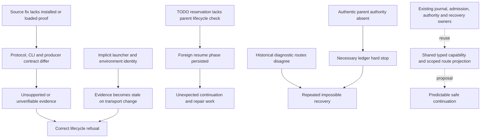

# Systemic resilience audit — SRC-215 / T-1716

Audit date: 2026-10-11. Mode: AUDIT_ONLY. Source SHA256:
`8d54708e5daccb690cc464918d4c81d7f1d2d4ed0f036a62a6e0c2f5ab0c2ce6`.
Current production fingerprint:
`2df2566be72aeb7bde515aadf1891ccb56bd24500385b60c483656fa0259fcaa`.
This is a bounded Tier 2 investigation, not an exhaustive security audit.
Graph project `saipen` is ready but its coverage generation is
2026-09-01T13:16:39Z; `tools/` is excluded and changed documentation is stale.
Exact current source, hashes and definition ranges are in `source-catalog.json`.
No graph-negative claim establishes absence. Original consumer files, claims,
history, permissions and installed runtime generations were not changed.

Evidence abbreviations used below:

- **C**: `controls.json`, with raw execution in `scout-controls-corrected.json`.
  Real canonical operations on disposable fixtures; self-child zero-write
  negative controls, active-parent comparison and state-mode input variation.
  `scout-controls.json` preserves an initial audit-adapter argument error,
  corrected before drawing any production conclusion.
- **W**: `consumer-current.json` and `scout-consumer-current.json`: fresh,
  read-only status, canonical hashes and strict history reads for SAI_WEBSITE
  and Wintage. Before/after consumer hashes match within each bounded probe.
  These are point-in-time observations, not a lock on other sessions. During
  report verification Wintage independently advanced to BUILD/T-927 at E-3613
  (STATE updated 2026-10-11T14:41:51Z); its earlier DONE/E-3611 observation
  remains historical. `consumer-refresh.json` records a later read-only probe:
  VERIFY/T-927 at E-3614, successful native status, unchanged bytes during the
  probe. SAI_WEBSITE remained VERIFY/T-31 at E-356 in both observations.
- **D**: `build-root-status.json`: actual public launcher status. Its snapshot
  preceded the BUILD transition; the phase field is historical SCOUT.
- **R**: `scout-runtime.json`: public runtime schema 1; host metadata unknown.
- **H**: `source-catalog.json`: 43 exact source/document/test hashes, definition
  ranges, eight original root events and source fingerprint.
- **A**: `../T-1711-admission/REPORT-FINAL-GENERATION.md`: prior repaired
  active evidence contract, 42-case unchanged oracle and native entry controls.
- **L**: `../T-1714-diagnostics/FINAL-ACCEPTANCE.md`,
  `review-pair-resumed.json`, `review-real-copy.json` and
  `verifier-context-comparison.json`: local A05 repair, independent execution,
  original AUDAPACK copy preservation and exact launcher-context diagnosis.

## 1. Executive verdict

The observed incidents do not prove that integrity and autonomous continuity
are incompatible. Current owners already implement scoped blockers, read-only
inspection, canonical recovery, bounded continuation authority, journaled
operations, exact replay, runtime discovery and advisory host degradation.
Several severe historical failures were missing or inconsistent implementations
of those contracts. The strongest current reproducible defect is a missing
parent-lifecycle check in dependency reservation, already owned by T-1715.

There is also an architectural availability risk: callers must reconstruct a
capability and evidence-admission contract spread across protocol, CLI,
installation, verifier context and host integration. Correct local fixes do not
automatically reach installed or loaded consumers. D reports seven installed
homes stale, two unknown, and 215 changed injected-surface paths; publication
is intentionally refused as DIRTY_SOURCE. This audit does not authorize its
commit, installation or release.

No new P0 integrity escape was established. The source's suggested P0 labels
are hypotheses; retaining them without a current demonstrated violation would
inflate the queue. Preserve hard integrity and authorization stops; improve
capability discovery, operation-scoped continuation and tested recovery routes
through existing owners. The dependency-ordered queue is in `ROADMAP.md`.

## 2. Confirmed systemic problems and bounded findings

Every finding names its responsible layer; consumer observations are not
silently attributed to the engine. Prior repairs remain local unless actual
installation and loaded-generation evidence proves otherwise.

### F01 — P1: a TODO parent borrows another Work's resume phase

**Incident/reproduction:** H includes original E-14412 and E-14444/45/47.
T-1714 was unclaimed TODO when parked while T-1711 was in VERIFY; dependency
completion later restored T-1714 into VERIFY. C reproduces the current defect:
unclaimed T-8 gets `resume_phase: VERIFY` from active T-7. Active T-7 handoff
works correctly; self-dependency refuses without canonical writes.
**Authority/current/expected:** OPS's owned active-parent handoff contract
versus `operations._ticket_targets`, which admits block-for over DOING or TODO
and copies STATE's phase. A scheduling dependency on an unstarted ticket must
not invent that ticket's lifecycle. **Owner:** runtime operations/board
continuation; protocol already states the intended active-parent restriction.
No host or consumer defect is required for the reproduction.
**Remediation:** T-1715, require a provably active owned parent for lifecycle
handoff, or separately model a TODO ordering edge that resumes at SCOUT.
**Safety/acceptance:** no history rewrite, no synthesized claim, no borrowed
phase, old valid active handoffs and plain TODO blocking preserved; wrong
owner, TODO parent, invalid child, replay and restart controls must pass.

### F02 — P1 delivery gap: local fixes and installed generations diverge

**Incident/reproduction:** D returns DIRTY_SOURCE, seven stale installed homes,
two unknown and 215 changed injected paths. W's native status uses this root's
current engine; it does not prove the original FreeBuff session loaded these
instructions. Both inspected installed saipen skill entries are thin BOOT
adapters, not evidence of a current loaded regression-command contract.
**Authority/current/expected:** RUNTIME freshness and publication owners
correctly refuse edited, unpublished surfaces. Expected behavior is an honest
capability/freshness diagnostic and an authorized delivery pipeline, not
automatic publication from a dirty audit tree. **Owner:** installation and
host transport; the publication boundary is correct. **Remediation:** expose
source/installed/loaded identities and supported contract versions in one
read-only handshake; separately review and authorize delivery.
**Safety/acceptance:** no no-publish override, unknown remains unknown,
stale-host matrix must refuse unsupported mutation while retaining safe reads;
successful delivery requires actual installer and fresh-session evidence.

### F03 — P2: verifier transport is implicit, causing avoidable remeasurement

**Incident/reproduction:** L preserves an initial stale-evidence diagnostic
despite unchanged oracle and subjects. The public CMD launcher uses a different
absolute Python path and adds PROMPT. Both Python binaries are 3.11.9 and have
the same SHA256. Reexecution through the exact launcher restores a current
receipt without weakening a gate. **Authority/current/expected:**
`regression_execution._load` deliberately binds runtime path/hash and the whole
environment after filtering SAIPEN variables, then adds fixed child settings.
The refusal is correct under that contract; calling it proven false admission
would be wrong. Expected diagnostic identifies which nonsecret context
category changed and how to reproduce the declared verifier.
**Owner:** runtime evidence producer and launcher contract; the audit harness
also initially used the wrong transport. **Remediation:** publish a versioned
invocation/context description, bind a managed verifier environment and test
any semantic normalization before changing identity rules.
**Safety/acceptance:** keep runtime/oracle/subject/contract/prior integrity;
never print secrets or blindly ignore environment differences. Meaningful
PATH, import, locale or runtime changes still invalidate evidence. Harmless
prompt/path equivalence is an explicit future policy decision, not this audit's
authority. This individual measurement is resolved locally by L.

### F04 — P2 contract gap: `cc all` has no native positional grammar

**Incident/reproduction:** C executes the public launcher with `cc all --json`:
VALIDATION_FAILED, detail `Use: gg <objective>`, zero production canonical
changes. **Authority/current/expected:** `saipen._continue` rejects surplus
arguments before state mutation; commands owns a closed alias registry.
Bare cc and continue are continuation; gg creates a goal. The refusal is
legitimate for the current grammar, but its advice can turn a human's
continuation intent into duplicate generic Work if followed blindly.
**Owner:** CLI/skill compatibility and ingress transport, not authority proof.
**Remediation:** either document the supported forms and give intent-specific
diagnostics, or admit a narrowly defined equivalent alias through that owner.
**Safety/acceptance:** malformed payloads remain zero-write; no new Source,
goal pivot, budget reset or persistent authority may follow from alias spelling.

### F05 — P2 investigation: historical STATE.mode conflicts with live capability

**Incident/reproduction:** C varies only disposable STATE.mode. With live
no-publish, capability.may_mutate is true; mode full admits an ordinary write,
mode read-only refuses PROTOCOL_MODE_READONLY, restoring full admits again.
Reads stay available and direct canonical writes remain refused.
**Authority/current/expected:** capability.py explicitly calls STATE.mode a
last-handshake historical fact, unable to grant or revoke the current session;
admission.protocol_snapshot still treats it as a brake. CORE's capability
wording needs resolution with the existing owner. **Owner:** capability and
admission contract, not a proven host failure. **Limit:** synthetic input
conflict, no authenticated production transition from read-only to full has
been reconstructed. No live false-block incidence or rate is claimed.
**Remediation:** first reproduce the real supported producer sequence; then
resolve which source owns current capability. **Safety/acceptance:** a live
read-only session must never gain mutation from stale full state, and a session
must never grant itself full by editing STATE. Keep protected namespaces closed.

### F06 — P1 historical, locally repaired: active regression admission was incomplete

**Incident/evidence:** W's SAI_WEBSITE T-31 E-336–354 and A. A confirmed the
missing active execution contract and weaknesses in self-declared identity and
Attempt pairing, then repaired them under T-1711. **Current/expected:** current
`work regression ... --file` actually measures both subjects and produces bound
receipts; ordinary PASS and unsupported run/declare text are not authority.
T-31 remains VERIFY, with NO_REGRESSION_EVIDENCE in W. It has no actual current
pair, so refusal now is correct. **Owner:** historical upstream runtime/CLI
contract; consumer attempts at unsupported syntax are a separate contribution;
original loaded skill/host generation is unknown. **Remediation:** reuse A's
supported contract in a separately owned consumer continuation, plus F02.
**Safety/acceptance:** original consumer owner/session must admit it, actual
unchanged oracle and changed subjects, same Attempt/current cycle, ordinary
verification and journaled lifecycle all required. Do not invent old events.

### F07 — P1 historical diagnostics, locally repaired: unrecoverable ledger looked repairable

**Incident/evidence:** L's real copied AUDAPACK provenance, 13-case oracle and
current reconcile source. Missing parent authority is genuinely unrecoverable
from the available bytes; the historical defect was contradictory status/next/
explain advice that named ordinary repair. T-1714 now emits the registered
terminal/history classification through the existing reconcile owner.
**Owner:** runtime diagnostics/recovery; original integrity loss is not cured
by diagnostic consistency. **Remediation:** preserve this fix and extend the
owner's typed affected-operation/independent-lane reporting. **Safety/acceptance:**
never synthesize a missing event, preserve originals, keep healthy and genuinely
repairable/foreign-tail cases distinct, prove all named routes on fixtures.
Actual restoration still needs authentic missing authority or a separately
authorized lossless migration; no such authority is assumed.

## 3. Rejected or unproven hypotheses

- “Every refusal stops the whole project” is disproved as a universal claim:
  admission permits reads early, pending-operation targets can isolate
  unrelated effects, ticket blockers differ from global STATE brakes and the
  parallel gate lane already exists. Individual overbroad cases still need
  exact-target reproduction.
- “Twenty tickets is always an unnecessary operator stop” is false. Bounded
  grants stop; proven persistent grants checkpoint. Losing or lacking a
  trustworthy carrier cannot be repaired by an agent declaring persistence.
- “T-31 failed because a stale REVIEW slot dominated everything” is unproven.
  E-352 reports it, but the captured window contains ordinary prose, unsupported
  verbs and literal undecoded --hex text. That does not establish the claimed
  authoritative pair. A proved a different upstream omission.
- Wintage's cited E-3286 sidecar is absent by lstat; the initial snapshot was
  DONE/task none at E-3611 with successful status. It later started T-927.
  Its historical failure is not
  a currently reproduced global block; original sidecar contents are unavailable.
- “A local PASS proves consumer repair” is rejected. Source, installed and
  loaded generations, active claims and actual consumer acceptance are separate.
- Neither schema-version equality nor equal binary hashes alone proves
  compatible evidence semantics. F03's current path/environment identity is
  intentional; normalization needs a versioned contract and negative controls.
- Unknown host metadata and advisory enforcement do not prove a fail-closed
  OS security boundary. Same-user source/hook control is a stated limitation.

## 4. Root-cause dependency graph

The diagram distinguishes observed dependency from a proposed correction.
It is a causal model of this bounded evidence, not proof that every incident
has one root cause.

Minimum coherent invariants: one owner per decision; producer/consumer contract
agreement; authority scoped to project/Work/session/effect; no phase or claim
synthesis; integrity before selection; compare-and-swap commit of measured
inputs; typed recovery with executable negative controls; independent safe
lanes cannot imply authoritative success. These eliminate classes rather than
adding named-consumer exceptions.

## 5. Incident-to-cause map

| Family and original evidence | Proven cause and present disposition | Attribution / remaining uncertainty |
|---|---|---|
| A — bounded continuation, current goal counters and test_t1494_continuation_authority | Bounded/persistent authority are distinct; current audit is below the 20-ticket/3-wave valve. Tests exercise actual provenance and zero-write exhausted refusals. | Runtime/protocol boundary is intentional. A production claim of an authentic persistent goal wrongly stopped at 20 is not established by the inspected incident window. |
| B — E-7715/7716, T-1436 tests | Historical dependency completion synthesized live ownership; current tests require an unclaimed parent unless the same live session is proven. | Upstream lifecycle implementation, repaired historically. No fresh reproduction of this old defect is claimed. |
| B — E-14412/14444/14445/14447 and C | Distinct current TODO-parent resume-phase defect, F01. | Upstream operations; existing T-1715 owns correction. |
| C — T-31 E-345/346/352, A, D | Missing active evidence entry was confirmed and locally repaired; installed/loaded delivery remains separate. | Runtime/CLI omission plus consumer unsupported invocation. FreeBuff original tool transcript and loaded generation are unknown. |
| D — AUDAPACK original copy and L | Real missing-parent integrity loss plus previously inconsistent recovery advice; local diagnostic repair verified. | Recovery/diagnostic owner. Missing original authority cannot be manufactured. |
| D — Wintage cited sidecar and W | Status succeeds in the initial DONE/E-3611 snapshot, cited historical carrier absent; later independent BUILD/T-927 at E-3613. | Historical cause unresolved; no current global failure proved. |
| E — E-7976/E-7995, test_t1458_queue_reservation | Historical router selected a receipt form start refused and outranked reserved continuation. Current tests share ingress eligibility and reserved-child priority. | Upstream routing consistency, repaired historically. |
| E — current admission source and C | Existing read/target isolation; mode inconsistency only synthetic, F05. | Further authentic producer and affected-target tests required before broadening permissions. |

SAI_WEBSITE detail: W snapshots VERIFY/T-31 at E-356, not the report's E-354.
E-336/337 are ordinary red/green prose, E-338 BUILD, E-340 a new VERIFY boundary;
E-342/351 contain literal --hex text. E-348 opens A006 superseding A005.
E-349–354 describe candidate close/browser success, not a current admitted
regression execution. E-355/356 admit new Sources into T-32/T-33. Engineering
claims may be useful observations; none substitutes for T-31's current oracle.

## 6. Current architectural constraints and owners

| Responsibility | Existing owner and constraint |
|---|---|
| Single writer / durability | lock.py OS lock; plan.py and journal.py preconditions, operation provenance and recovery. A nonauthoritative lock filename is not ownership. |
| Tool effect and safe lane | admission.py plus guard_events.py; exact full target sets, protected namespaces, actor/project binding and TREE_UNDER_TEST. Unknown target scope cannot imply independence. |
| Ownership / continuation | operations.py, board and router; real live leases and reserved dependencies. F01 is a missing check in this owner. |
| Recovery / refusal | reconcile.py and remediation.py registered typed routes. Immutable classified cases are not repair commands. |
| Goal authority | goal_authority.py; committed, current operator provenance versus bounded agent continuation. |
| Runtime/skill compatibility | commands.py registry, runtime_surface.py, host_integration.py and RUNTIME.md; installation and loaded proof differ. |
| Evidence admission | regression_execution.py and log selectors; exact verifier/context/subject/contract/prior/Attempt/cycle and journaled native producer. |
| Remaining work / completion | automation.py and conformance.py; current source/audit generation and closure proof, never assistant prose or empty BOARD alone. |
| Host iteration | iteration_verdict.py, typed semantic capability requirements and current phase; identity labels do not supply capability. |

Canonical history integrity is a real shared dependency: if authentic history
cannot be read, authoritative mutation derived from it must stop. Ordinary
inspection can remain available. Unknown overlapping effects or provenance
cannot be made safe by renaming a failure DEGRADED. The current implementation
has no demonstrated OS isolation against a malicious process controlled by the
same user; this audit evaluates cooperative protocol enforcement.

## 7. Proposed containment model

These are proposed diagnostic outcomes, not new authoritative STATE.phase
values. Extend existing projections; no parallel state machine.

| Outcome | Admission and containment | Exit proof |
|---|---|---|
| NORMAL | Supported capabilities, current evidence and owned effect; normal gates apply. | Existing typed admission and lifecycle evidence. |
| DEGRADED | One capability/evidence service unavailable; retain known independent reads, scratch observations and explicitly admitted unaffected Work. Missing host enforcement remains disclosed. | Fresh capability/evidence proof, with no authority inferred from observations. |
| QUARANTINED | Preserve suspicious bytes and exact affected targets; deny their authoritative use and overlapping effects. Unrelated Work requires proven independence and sound common history. | Existing owner verifies provenance, replay and lossless repair; promotion is a new journaled decision. |
| HARD_STOP | Authentic shared integrity, conflicting ownership, revoked authority or explicitly forbidden effect prevents that authority domain's mutation. Reads and safe diagnostics may survive. | Authentic repair/authorization by the responsible owner; never retry count alone. |

Lifecycle admission and engineering permission are separate. An owned sound
VERIFY session may inspect/test and produce observations before a pair exists;
it may not claim REVIEW/DONE. Under corruption, use a permitted disposable
copy or evidence/scratch lane only after effect admission, preserve original
provenance and label results non-authoritative. A copy does not grant a claim
on the original project. No recommendation here bypasses an installed guard.

Narrow locks only where exact disjoint targets, read dependencies and absence
of shared canonical authority can be proven. Keep the canonical LOG/BOARD/
STATE single-writer transaction. Do not split its lock for throughput. Future
parallel ordinary engineering needs immutable snapshots, fencing and
compare-and-swap promotion; broad global unlock is unsafe.

## 8. Safe continuation decision matrix and blocker taxonomy

Each row supplies stopped effect, independent lane, recovery, retained evidence,
human boundary, retry condition and authority/duplicate-effect risk. “Continue”
always means current authorization and effect admission, never ignore a guard.

| Class | Stop / independent safe lane | Permitted recovery / retained evidence | Human requirement / automatic retry | Risk and required outcome |
|---|---|---|---|---|
| True integrity or security violation | Stop authoritative reads used for decisions and dependent mutations; preserve raw read-only diagnostics. | Existing lossless recovery or authentic backup; retain bytes, hashes, lineage, operation receipts and conflicts. | Human only for missing authentic authority or a declared destructive migration; retry after new verified authority, never a timer alone. | Fake history or laundering a corrupt receipt; QUARANTINED or HARD_STOP over the proven domain. |
| Missing authorization | Stop that transition/publication/destructive effect; continue independently authorized local work. | Recover existing authentic grant, never create it; retain request, scope and revocation evidence. | Human supplies only the missing decision; retry after a verified scoped grant. | Silent scope widening or agent self-authorization; HARD_STOP for the effect. |
| Unsupported runtime capability | Stop calls requiring the absent feature; retain supported reads, planning and admitted unaffected operations. | Discover supported version/producer or authorized install; retain source/installed/loaded IDs and schema. | Human if installation or expanded capability is unauthorized; retry on verified capability change. | Guessing commands or interpreting unknown as full; DEGRADED. |
| Temporary infrastructure failure | Stop dependent process/network effect; independent local observation can continue. | Bounded retry/backoff, owned process cleanup and checkpoint; retain argv category, exit, timeout and external idempotency key. | Human only after actionable external prerequisite or budget exhaustion; retry on readiness and remaining budget. | Duplicate external side effect after ambiguous timeout; DEGRADED until receipt reconciliation. |
| Stale or incompatible evidence | Stop promotion/closure spending that evidence; retain current safe tests and observation capture. | Remeasure through supported producer/context; preserve old and new hashes and rejection reasons. | Human only for genuinely missing oracle/permission; retry after relevant inputs or supported contract change. | Selecting an older PASS over newer FAIL, weakening the oracle; QUARANTINED evidence. |
| Recoverable state divergence | Stop dependent canonical mutations; inspection and proven disjoint lane survive. | Existing journal/reconcile dry-run then admitted lossless transaction; retain preimages, plan and all receipts. | No human for a proven deterministic repair already authorized; retry after repair proof, bounded/idempotent. | Duplicate transition or dropping partial evidence; QUARANTINED then NORMAL. |
| Resource or claim contention | Stop effects on contested Work/targets; independent reads and separately owned disjoint Work may proceed. | Wait for OS lock release, live lease completion or witnessed stale takeover; preserve lease generation/session and timestamps. | Human only for unresolved conflicting authority, not ordinary busy lock; retry after observed ownership/release change. | Stealing live claims or retrying an already committed effect; DEGRADED scoped contention. |
| Test or environment failure | Stop approval relying on failed test; inspect, reproduce and admitted BUILD correction can proceed. | Diagnose code versus harness, preserve failed streams and unchanged oracle, rerun changed condition. | Human if required environment/credential unavailable; retry after a material change, within limits. | Calling flaky green or fewer tests a fix; DEGRADED verification, no lifecycle promotion. |
| Consumer implementation defect | Stop that consumer's affected workflow; upstream independent audit remains possible. | Owner-approved correction or disposable reproduction; preserve consumer revision, transcript and acceptance oracle. | Human only for consumer ownership/access/requirements not granted; retry after the actual consumer correction. | Claiming upstream repair or seizing another claim; scoped DEGRADED. |
| Protocol implementation defect | Stop unsafe/refused affected operation; safe upstream investigation and unrelated admitted effects remain. | Reproduce against existing law, own a bounded patch through normal lifecycle; retain original counterexample and red/green evidence. | Human only if changing law/authority is necessary; retry after verified implementation reaches its consumer. | Exception pile or alternate authority path; scoped QUARANTINED/DEGRADED, HARD_STOP if shared integrity. |
| Incorrect refusal | Stop repeated identical retries, not all authorized independent work. | Prove failed predicate and exact effect, repair responsible classifier/route through owned Work; retain unchanged negative controls. | No human for an authorized implementation fix; human for a real contract decision; retry after the relevant predicate changes. | Mislabeling correct safety refusal to bypass it; scope determined by proof. |
| Undetermined, needs investigation | Stop only effects whose safety cannot be established; retain known safe reads. Unknown scope prevents consequential continuation. | Bounded diagnosis, immutable snapshot and explicit evidence gap; retain raw failure and all unknown fields. | Human when only the operator can resolve missing authority/input; retry after discriminating evidence, not confidence prose. | Optimistic classification or indefinite loop; DEGRADED or HARD_STOP according to unknown shared dependency. |

Continuation decision order: resolve binding and current authority; identify
effect and complete targets; validate common history/ownership; classify the
failed invariant; select an existing registered route; prove independence of
remaining work; record the checkpoint and execute one admitted action. The
same inputs must produce the same verdict in router, guard and automation.
Neither a classified observation nor a recovery recommendation is a success.

Goal/cc/converge budgets remain separate from ticket ownership, lifecycle
evidence and external permission. Bare cc resumes; cc all is not a supported
native positional form; gg starts a scoped goal; convergence requires current
closure conditions. Persisted valid goal authority may checkpoint across
bounded work segments. A model-supplied capsule cannot upgrade a bounded
grant. Cancellation/revocation takes effect at the next admitted boundary;
resource, wall-clock and host budgets cannot be reset by retrying aliases.
Checkpoint source, Work, generation, last committed effect and any ambiguous
external result before continuation. Resume only after reconciling that result.

## 9. Evidence recovery strategy

Use the existing journal and evidence producer. Validate provenance/digests
before selection; bind project lineage, actor/session, Work, acceptance,
VERIFY cycle, Attempt, runtime/oracle/context/subjects, prior material and
contract. Recheck them under the commit owner's preconditions. Newer failure,
changed inputs or a new cycle must prevent stale PASS selection. Exact replay
returns existing authority without appending a second transition.

Proposed pending observations are non-authoritative artifacts under an
existing evidence store, with immutable raw input, producer/schema, observed
time, claimed subject, hashes and explicit admission failure. They are not
LOG events, regression halves or votes. Capture may precede full capability
availability. Promotion must revalidate every required binding using the
supported native producer, execute actual tests where required and create a
new committed receipt/event; preserve the rejected observation and linkage.
No backdating, manually constructed old parent, or narrative FAIL-to-PASS
conversion. If current ownership/Attempt cannot be proved, the observation
remains pending or rejected, even if engineering was useful.

Crash tests must cut after each durable target and journal step, then restart
the canonical recovery path. The outcome must be original or one fully
committed operation, with evidence retained and repeat recovery idempotent.
Malformed/truncated records, concurrent oracle/contract change, unavailable
sidecar and ambiguous external timeout need distinct controls. Migration uses
versioned readers, immutable old carriers and a linked new receipt, never
rewrites historical signatures. Missing authentic ledger ancestry remains a
hard boundary. T-1714's diagnostic fix does not reconstruct it.

## 10. Capability compatibility strategy

Build a read-only versioned capability description on the commands/runtime/
host owners: command grammar and effect class; producer/schema versions;
formats; semantic required capabilities; source, installed and loaded
generation; observed versus declared enforcement; project schema; evidence
profile and supported migration. Fields need explicit supported/unsupported/
unknown states. Bind the handshake to the active host session; stale loaded
proof cannot be replaced by a source-tree PASS. R currently supplies schema 1
but unknown host metadata, so this audit does not invent host capabilities.

An old skill first performs bounded discovery, chooses a supported route, or
reports unsupported capability while continuing safe admitted work. Do not
guess run/declare, silently downgrade executed evidence to attestation, or
start new Work just because cc had an extra token. Existing legacy attestation
may remain explicitly versioned for legacy Work; requiring executed evidence
must be monotonic for Work that opts into it. Cross-version tests must cover
old producer/new reader, new producer/old reader, unknown future schema and
unsupported features, including a real JavaScript consumer pair.

Semantic compatibility belongs at the declared interface. Canonical source,
ledger and receipt hashes remain exact. runtime_surface already distinguishes
LF-normalized text surfaces from binary bytes; that does not license
normalizing signed history or evidence identity. Any new normalization must
state the equivalence relation, version it, preserve the original and prove
negative controls for meaning-changing differences. Keep active capability
separate from a historical mode field; resolve F05 before changing enforcement.

## 11. Model-based and negative-control test plan

H inventories current test definitions; VERIFY execution results are recorded
in `VALIDATION.md`. Existing tests are examples over bounded fixtures, not
proof of all possible states. This audit adds counterexample controls without
editing the production test suite.

| Requested invariant | Existing concrete coverage | Missing proof / next control |
|---|---|---|
| I01 Unauthorized lifecycle transitions never succeed | test_regression_gate and test_t1711_regression_execution reject false pairs, wrong actor, new Attempt/cycle and changed inputs. | Generated transition sequences including F01 TODO reservations, wrong-session resume and interrupted admission. |
| I02 Valid independent work survives unrelated failures | test_guard_admission reads/foreign-root controls; test_t1575_parallel_lane exact freeze and evidence lane. | Property tests over disjoint/overlapping/unknown pending target sets with common-history corruption boundaries. |
| I03 Recovery never fabricates evidence | test_recovery_reachability preserves original STATE and refuses real blockers; L covers missing-parent terminal classification. | Random missing segments/sidecars with no guessed ancestry, immutable preimage verification. |
| I04 Repeated recovery cannot duplicate authority | test_t1711_regression_execution exact replay and journal controls; recovery_reachability second CLEAN. | Crash at every write/flush/replace boundary, multiple restarts, repeated external ambiguous-result reconciliation. |
| I05 Supported commands match documentation | test_t1458_queue_reservation shares source eligibility; public native T-1711 probes; C cc-all refusal. | Versioned capability/skill/CLI table-driven consumer matrix, unsupported and malformed payload zero-write controls. |
| I06 Stale evidence cannot supersede valid newer authority | T-1711 newer-failure, Attempt/cycle, acceptance, context/contract/prior changes and forged checkpoints. | Metamorphic ordering, selector-before-integrity attacks, concurrent mutation at lock acquisition and cross-version receipts. |
| I07 Contention cannot corrupt persistent state | OS lock owner, test_dependency_resume_liveness and actor binding; no live claim synthesized by dependency completion. | Multi-process adversarial interleavings, process death during durable commit, lock path aliases and stale lease fencing. |
| I08 Agent cannot silently widen authorization | test_t1494_continuation_authority distinguishes real carrier from model input, bounded exhaustion and revocation. | Host ingress replacement/replay/cancel across checkpoint, explicit lower user limit and publication permission independence. |
| I09 Local failure cannot invalidate unrelated verified work unnecessarily | Scoped guard/parallel lane, T-1711 Work/Attempt and consumer isolation. | Multi-Work receipt sets: unrelated source changes versus common oracle/contract dependency changes; test both expected outcomes. |
| I10 Every hard refusal names failed invariant and operation | remediation registry and L diagnostic/route controls. | Bounded registry audit of affected-target fields, executable permitted routes, exact human escalation and terminal classifications. |

Test design: represent authority, Work phase, claims, targets, evidence state,
journal stage and runtime generation in a small reference model. Generate
bounded legal and illegal command sequences, compare engine/guard/router/
automation outcomes and shrink counterexamples. Add fault injection at owned
storage and process boundaries, process crash/restart, deterministic seeded
concurrency schedules, and Linux/Windows runs. Metamorphic controls vary
unrelated file/order/locale/launcher while keeping declared semantics fixed;
meaningful verifier, subject or authority changes must refuse. Each proposed
continuation capability needs a safe positive, unsafe negative, replay,
no-write refusal and retained-evidence check. Real consumer contract probes
are disposable first; final live acceptance needs that consumer's authority.

## 12. Resilience KPIs

No baseline or percentage is computed here. Existing status withholds its
conditional efficiency KPI because ticket-scoped telemetry is insufficient;
its coarse shared CLI identity cannot classify unnecessary human cost. These
seven metrics are proposed measurements, not release gates in this audit.

Collect immutable typed attempts linked by operation intent, Work, session,
generation and recovery episode. Dedupe retries by intent; independent review
labels correctness, recoverability and operator necessity using the contract
in force. Report unknown/unclassified counts and denominator coverage alongside
every rate. Never improve a rate by dropping failed operations or relaxing
integrity. Suggested intervals below are reporting choices, not new authority.

| Metric | Source of truth / collection | Numerator and denominator | False-positive and gaming risk | Interval |
|---|---|---|---|---|
| FALSE_BLOCK_RATE | Typed refusal/admission records + independent resolved predicate review; link exact effect and generation. | Confirmed incorrectly blocked distinct operation intents / all blocked intents; show unknown count and uncertainty bounds, withhold a point estimate until classification is complete. | Correct authorization stop mislabeled false, retry spam inflates denominator, omit unresolved cases. | Weekly and each release cohort. |
| AUTONOMOUS_CONTINUITY_RATE | Canonical Work/effect checkpoints + operator ingress provenance and eligibility review. | Eligible safe segments completed without unnecessary intervention / all eligible safe segments, including pending and failed cohorts. | Split easy segments, hide abandoned segments, call legitimate authorization requests unnecessary. | Weekly; cohort closure and open-count disclosure. |
| RECOVERY_SUCCESS_RATE | Journal/reconcile episode receipts + eligibility classification fixed before outcome. | Automatically restored eligible failures / all automatically recoverable failures in cohort; separately pending and censored. | Exclude hard recoverable cases, redefine eligibility after failure, count diagnostic success as restored authority. | Weekly, plus per recovery change. |
| OPERATOR_INTERRUPTS_PER_100_TICKETS | Witnessed operator ingress linked to Work/reason + canonical unique DONE tickets. | 100 × unplanned independently classified interventions / distinct completed tickets; publish interventions on still-open Work separately. | Inflate trivial tickets, hide human actions, charge planned approvals as interruption or drop long blocked Work. | Monthly and release cohort. |
| BLOCKER_RECURRENCE_RATE | Stable reviewed cause IDs, resolution generation and later typed incidents. | Distinct resolved cause classes recurring in a newer observed generation / previously resolved cause classes actually exposed to comparable operations. Also publish incident volume. | Rename recurring causes, claim unexposed classes as denominator, collapse distinct defects into one. | Monthly and per release. |
| MEAN_RECOVERY_TIME | Same recovery episode's first detection and first proved restored authorized operation, monotonic durations where available. | Sum elapsed recovery durations / completed recoverable episodes; report p50/p95, open ages, timeout/cancellation and right-censoring separately. | Reset clock on retries, omit slow open cases, confuse wall time/timezone or count diagnostic return as recovery. | Weekly with monthly cohort follow-up. |
| INTEGRITY_VIOLATION_RATE | Independently confirmed provenance/authority/canonical-state violations linked to evaluated authoritative intents. | Confirmed distinct violated authoritative intents / all evaluated authoritative intents, successful and refused; unknown inspection coverage explicit. | Remove refused attempts, count only detected classes, dilute with diagnostic reads or cheap repeated calls. | Every release and weekly incident review. |

## 13. Ranked remediation queue

`ROADMAP.md` is the implementation-ready handoff. Dependency order:
RSL-01 (existing T-1715) → RSL-02 discovery → RSL-03 scoped decision projection
→ RSL-04 pending-observation/recovery contract → RSL-05 model/fault matrix →
RSL-06 telemetry. RSL-07 deployment proceeds only under its separate review
and publication authorization; F02 cannot be closed by local tests. RSL-08
resolves F05's authentic producer sequence before any enforcement change.

Priorities: P1 for the reproduced lifecycle defect, contract/delivery
compatibility, recovery containment and meaningful state-machine coverage;
P2 for context diagnostics, grammar usability and metrics. No current new P0
is asserted. Escalate only if new evidence proves unauthorized authoritative
transition or an avoidable shared hard stop with no independent safe route.
Do not duplicate existing T-1715, T-1711, T-1714 or the parent SRC-205 roadmap.
Audit roadmap identifiers are proposed work, not self-granted implementation.

## 14. Migration and regression risks

The highest risks are giving stale evidence new authority, widening scope
through a “safe lane,” breaking legacy consumers by silently requiring a new
schema, treating a pending observation as a historical event and changing
verifier equivalence without a declared contract. Dual readers may be needed;
dual authoritative writers are not. Carry old bytes and versioned semantics,
promote only through one journaled owner and retain rejection evidence.

Roll out diagnostic/discovery fields additively first, then opt-in consumers,
then supported producer changes with cross-version acceptance. Unknown fields
must not grant capabilities. Keep existing full/no-publish/read-only policy
and active-session authority. Do not bundle the unrelated dirty source tree
into an audit release. A rollback disables new optional projection/producer
selection while preserving all old receipts; it never deletes committed
history to make tests green. Every compatibility release needs fresh loaded
host proof separately from source and installed hashes.

## 15. NON_GOALS and audit boundary

This audit changes no production enforcement or schema, consumer project,
installed skill, hook, permission, claim, historical event, release, tag or
commit. It does not repair SAI_WEBSITE T-31, close unrelated Work, reconstruct
AUDAPACK ancestry or execute a production resilience redesign. Only authorized
T-1716 lifecycle recording, evidence, report and proposed queue are written.
It does not promise exhaustive state-space coverage, mechanical enforcement
on advisory hosts, seven measured KPI baselines or an OS security boundary.

## 16. Unresolved runtime questions and six final decisions

Unresolved evidence: original FreeBuff tool transcript/loaded skill generation
for T-31; actual supported live producer of the F05 mode mismatch; historical
Wintage carrier contents; host runtime-info for this session; deployed and
freshly loaded receipt contracts across all seven stale/two unknown homes;
production incidence and denominator labels for every proposed KPI; arbitrary
cross-version and concurrency schedules beyond the bounded fixtures. Obtain
these through read-only diagnostics or separately authorized consumer sessions.

**Q1 — Implementation or architecture?** Predominantly demonstrated contract
implementation and delivery gaps in this sample, with a recurring architectural
interface risk from scattered capability/admission knowledge. Evidence does
not justify replacing the existing lifecycle/journal architecture.

**Q2 — Necessary hard stops or scoped degradation?** Stop shared corrupt
authority, unresolved ownership, revoked/missing permission and unsafe unknown
effects. Degrade unsupported capability, stale evidence, temporary resources
and ticket-local failure only to independently proved safe operations. Missing
authentic ancestry remains a hard stop for its authoritative domain.

**Q3 — Strict integrity with greater continuity?** Yes: separate observation
capture, engineering effect admission and authoritative promotion; preserve
all hashes/provenance and use exact affected-target isolation. More continuity
does not require accepting weaker evidence or manufacturing a claim.

**Q4 — Smallest coherent sequence?** Fix T-1715's parent guard, add versioned
discovery, project existing scoped decisions consistently, then pending
observations and crash/replay proof. Add telemetry and separately authorized
delivery. Do not begin with a broad rewrite or another controller.

**Q5 — Existing owners to reuse?** commands/runtime/host for discovery;
admission/guard_events for effects; goal_authority for continuation;
operations/board/router for ownership; journal/plan/lock for durability;
reconcile/remediation for recovery; regression_execution/log for evidence;
automation/conformance for completion. A Resilience Layer is feasible as a
versioned projection/orchestration interface over these owners, not a second
authority, phase registry, remaining-work predicate or policy engine.

**Q6 — What proves safe continuation?** For each admitted lane: genuine scope
and session authority, sound common history, complete disjoint effects,
unchanged relevant inputs, positive and unsafe negative controls, zero-write
refusals, crash/restart/idempotent recovery and actual consumer contract proof.
Current local family PASS supports this generation's declared suite only;
unknown hosts and untested interleavings remain unknown. The concrete next
implementation owner is T-1715; the remaining sequence and acceptance gates
are `ROADMAP.md`, not authorization to execute them inside this audit.
