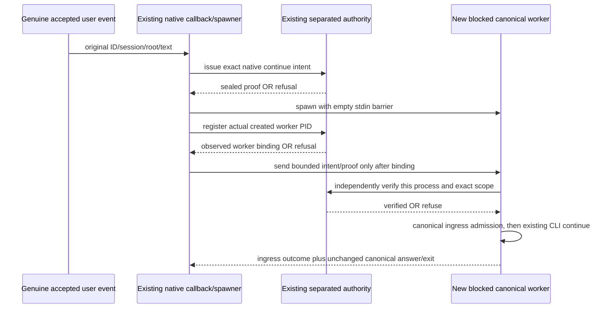

# Native continuation delivery — candidate contract

Defect: the broker verifies native event and worker records, but the checked
host adapters do not wire an authenticated producer to a consuming worker.
An uninstalled hook cannot be repaired by repeatedly spelling cc differently.

This is a candidate specification under the existing T-1858/T-1859 incident,
with T-1854's consumer/compatibility contract retained. No dependency, host
identity, installed capability or acceptance floor is waived or marked done.

## Owners and order

1. The host's existing accepted-input owner classifies a genuine user submission;
   model/automatic/wire-claimed real_user inputs remain excluded. It supplies
   the original accepted message ID, session, exact text, project and resolved
   current runtime. A missing original ID refuses; never generate a fake one.
2. Its native installed callback invokes the producer. The existing broker
   independently authenticates THAT callback's OS caller and shipped artifact.
   The producer uses issue_operator_origin; it creates no key or local witness.
3. The native spawner starts a worker blocked on stdin. It registers only that
   Popen child's observed PID through register_operator_worker before sending
   any intent/proof packet. Registration refusal closes/terminates that child;
   no ingress cache or canonical state is written by an unadmitted worker.
4. The worker bounds and checks the packet, requires a registry-declared resume
   input and continue-purpose proof, independently verifies the broker origin
   for this actual process/root/session/digest, then invokes admit_host_ingress.
   Only afterward does the SAME worker call the existing canonical CLI main
   with the continuation command. No manual counter write or replacement goal.
5. Native delivery success and the canonical continuation result are separate.
   A valid origin does not imply Work can run. Preserve the canonical exit,
   refusal and parsed answer; the existing host parser owns Work disposition.

The existing CLI/registry remain the command owners, broker remains the grant
owner, and CommandInbox remains the accepted-input/queue owner. No second queue,
signer, authority registry or evidence namespace is introduced by this proposal.

## Required controls

* Missing/invalid event, session, message ID, runtime worker file or resume
  grammar: refuse before issue/spawn, no canonical writes.
* Issuer denied/unreachable: no worker; original hard_wait persists.
* Worker registration denied: no packet delivered and child is reaped.
* Spoofed origin, wrong action/root/session/body, replay/revocation/expiry:
  independent kernel verification refuses before canonical ingress writes.
* Positive unit ports prove ordering and fidelity only; disposable broker
  identity doubles are explicitly not LIVE native evidence.
* A canonical Work refusal after valid ingress remains that refusal. Never
  translate transport success into goal or ticket completion.
* Interrupted producer before stdin delivery gives the worker EOF/refusal;
  timeouts reap only the owned child and preserve diagnostic output.

## Host wiring and activation still due

ZAICODE must call this only from its existing genuine accepted-input path and
return the canonical result through its existing continuation parser. Preserve
original message ID and lease/session/workspace identity, desktop/mobile
delivery semantics and native versus model classification. Do not trust an
arbitrary payload's real_user flag or invoke a before_tool/read event as a
native user callback.

The current ZAICODE adapter has no artifact/install surface or verified native
issuer. Its executable is unsigned and not in the broker's approved identity
policy. This candidate must remain refused there until an independently
approved native issuer and canonical installation are established. Do not trust
generic node.exe or bless a model-written image hash to make a test pass.

Production acceptance still requires deployed build identity, a fresh genuine
operator cc in the actual AUDAPACK/FastPrompter host, canonical budget renewal
and eligible continuation, with hostile/root/session/worker/replay checks.
No prototype result or mock identity satisfies those LIVE criteria.
