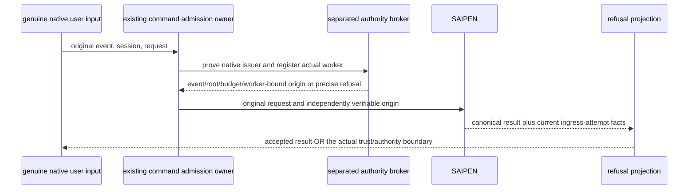

# ZAICODE continuation: reviewed diagnostic correction and remaining native boundary

STATUS: Diagnostic candidate tested in a scratch VM; not applied or deployed.
Owner: existing ZAICODE T-415 acceptance / SAIPEN T-1854 integration track;
incident acceptance remains open as SAIPEN T-1858 / SRC-290.

## Root cause

`commands/operator-ingress.ts` calls an optional native SAIPEN hook. The current
SAIPEN adapter declares no ZAICODE hook artifact or prompt binding. The positive
T-415 test explicitly substitutes this absent hook. Neither that test nor its
DONE/CLOSED record proves production native-input delivery. Do not manufacture
an issuer, signing key, environment witness, model-written envelope or receipt.

`commands/continue-diagnostics.ts::saipenRefusalCode` checks valve/operator
flags before its existing ingress failure states. Consequently a real attempted
request with missing trust transport is mislabeled as another human decision.
The UI already supports the correct infrastructure reason codes in
`packages/ui/src/v4/queueActionOutcome.ts`; no new vocabulary is necessary.
The model's claim that only the bare spelling cc works is false.

## Spec for the proposed classifier correction

One owner: the existing continuation owner supplies the canonical refusal and
the CURRENT ingress attempt. Diagnostics project those facts; UI reads the
existing reason code. No state, queue, lease, replay or authorization owner changes.

1. If the current attempt is undelivered and reports trusted-ingress-unavailable,
   broker-unhealthy or runtime-stale, preserve the refusal and select that exact
   existing infrastructure code before the generic valve/operator classification.
2. If delivery succeeded, ignore stale infrastructure annotations. Preserve the
   existing genuine valve/operator/generic refusal behavior.
3. Render the existing shared ingress description plus the original SAIPEN
   diagnostic. Never promise that a different command spelling supplies trust.
4. The input object stays unchanged. No branch returns command acceptance or
   executes a command. Existing queue refusal handling remains in force.
5. This correction does not install a hook or authenticate a native event.

## Concrete candidate and tests

`ZAICODE-continue-diagnostics.patch` contains the exact source delta.
`ZAICODE-continue-diagnostics.original.ts` and `.candidate.ts` retain the inspected
source and candidate. `host_diagnostics_fixture.cjs` executes the original and
candidate pure classifiers with the real existing shared and UI projections.
The unchanged oracle catches six masked infrastructure cases on the original;
all ten candidate cases pass, including four preserved refusal behaviors.
Node 24.22.1 / TypeScript 6.0.2. Source digests are in
`ZAICODE-diagnostics-test.json`. This is diagnostic-unit evidence, not native
authentication, deployment or live UI acceptance. Full repository typecheck/lint
were not executed for an unapplied foreign patch.

Freshness and `architecture:check --changed` ran read-only on the actual checkout:
fresh baseline, zero violations. The required bounded context identifies
zcode-cli as legacy/unmanaged; that result is not proof of stronger layer
enforcement. The shared public export is an existing dependency. The root and
nested AGENTS and architecture-governance skill were read. Spec precedes the
candidate; implementation comments explain the cause in Chinese as required.

## Required receiving-owner work

The native host must issue the original event through the existing separated
broker, register only the worker it actually created, and carry the bound origin
through the real tool/spawn path. Existing kernel methods live in
`saipen_engine.host_authority_client`: issue_operator_origin,
register_operator_worker, verify_operator_origin, revoke_operator_origin,
prepare_operator_goal and verify_operator_goal. These APIs do not make an
unproven native caller trusted. Establish the supported native writer identity
and actual callback/worker handshake; install a compatible declared adapter
only through the canonical installer. Do not substitute a before_tool/read JSON
envelope for a genuine user-input callback.

Prove actual deployed source/build identity, not just current checkout code.
The screenshots' model-switch staleRevision is not diagnosed or fixed by this
classifier patch. Do not assume which loaded executable/provider handled them.
Exercise real cc and equivalent continuation forms, genuine native approval,
same-event replay, wrong root/session/worker/budget, revoked/expired proof,
model imitations, and absent/stale broker/hook. Preserve the existing hard_wait
and original Source provenance. A test double cannot satisfy the LIVE floor
now declared on T-1858. No further instruction to retype cc can repair an
uninstalled or unverified native trust boundary.
